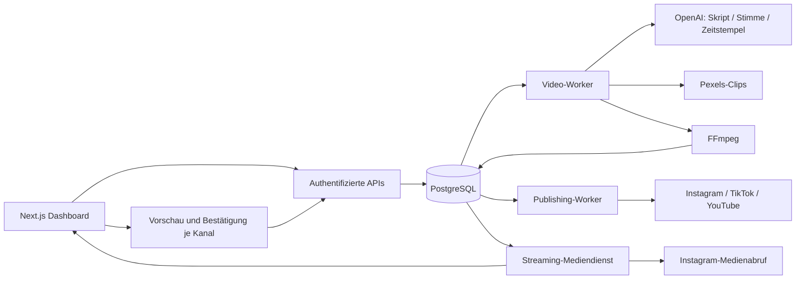
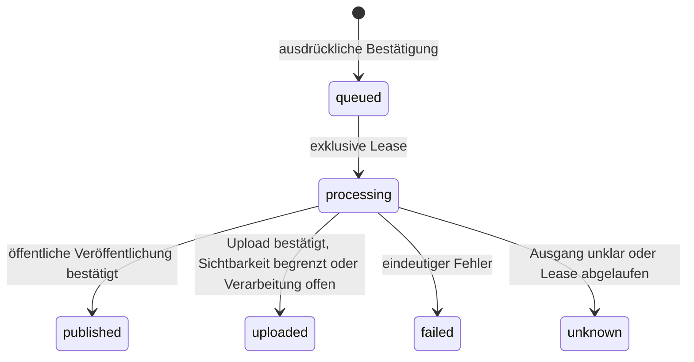

# ContentDock Architektur

Stand: 18. Oktober 2026. Diese Beschreibung unterscheidet den implementierten Ablauf von noch ausstehenden Produktionsfunktionen.

## Zugriff und Speicherung

Die öffentliche Demo hält Beispieldaten im Browser und führt keine Videoaufträge oder Veröffentlichungen aus. Im Dashboard prüfen Server Components und APIs eine signierte, zeitlich begrenzte Berechtigung. Ein authentifizierter Subject wird einem `app_user`, `workspace` und `workspace_member` zugeordnet. Rollen sind `owner`, `admin`, `editor`, `reviewer`; Schreibpfade prüfen die aktuelle Mitgliedschaft in ihrer Transaktion.

PostgreSQL speichert Workspace-Daten, Medien, verschlüsselte Provider-Verbindungen und dauerhafte Aufträge. Jede fachliche Abfrage bindet ihre Ressourcen an den Workspace. Row Level Security ist keine aktuell implementierte zusätzliche Schutzschicht. Die neue Funktionsprüfung und der unvollständige Audit sind in [SECURITY-REVIEW.md](SECURITY-REVIEW.md) beschrieben.

## Video und Veröffentlichung

`video_job` führt Thema oder Sprechertext über OpenAI, Pexels und FFmpeg zur fertigen MP4-Datei in `media_asset`. Fortschritt, Quellen und optionale SRT-Untertitel bleiben im Auftrag. Schlüssel für die KI-Verarbeitung werden nach expliziter Zustimmung höchstens eine Stunde verschlüsselt im aktiven Auftrag gehalten und bei terminalen Zuständen entfernt. Eine vollständig abgeschaltete Infrastruktur führt keine physische Bereinigung aus; Backups benötigen eigene Löschregeln.

Erst eine weitere Nutzeraktion erstellt eine `video_publication`. Instagram nutzt einen Reel-Container, TikTok FILE_UPLOAD und YouTube einen resumierbaren Upload. Jeder Worker prüft vor externen Aktionen aktuelle Mitgliedschaft, Zugangszeitraum, Kontoidentität und Berechtigungen. Gespeicherte IDs und verschlüsselte Upload-Zustände ermöglichen die spätere Abklärung unterbrochener Vorgänge.

Es gibt keine automatischen kostenpflichtigen Wiederholungen von Videoaufträgen und keine blinden Wiederholungen unklarer Posts. UUID-Auftragsschlüssel, Datenbankbedingungen, `FOR UPDATE SKIP LOCKED` und Leases behandeln doppelte Anfragen und konkurrierende Worker. Der Planungskalender speichert Entwürfe, Freigaben und Termine; zeitgesteuertes automatisches Publishing aus diesem Kalender ist noch nicht implementiert.

## OAuth und Geheimnisse

Instagram, LinkedIn, TikTok und YouTube verwenden den offiziellen OAuth-Login. Ein signierter, kurzlebiger State und ein providerbezogenes HTTP-only Cookie binden den Callback an den initiierenden Browser und Flow. Der Demo-Modus verwendet minimale Identitätsberechtigungen und verschlüsselte Cookies. Im Workspace liegen Tokens AES-GCM-verschlüsselt in `social_connection`; React erhält ausdrücklich projizierte Zusammenfassungen.

Für Veröffentlichungen zählen tatsächlich erteilte Scopes. YouTube und TikTok unterstützen Token-Erneuerung; Instagram erfordert bei Ablauf derzeit eine neue Verbindung. Nur Eigentümer und Administratoren dürfen Workspace-Verbindungen speichern oder entfernen.

Text-KI-Anfragen reichen den persönlichen Schlüssel einmalig weiter. Die Video-Queue benötigt die separat bestätigte befristete Speicherung. Betreiber-Pexels-Key, Workspace-Verschlüsselung, Social-Token-Verschlüsselung, Sitzungssignatur und Medien-HMAC haben getrennte Zwecke. Keine dieser Variablen gehört in `NEXT_PUBLIC_*`.

## Medienauslieferung

Uploads sind weiterhin größenbegrenzt; vom Worker generierte MP4-Dateien dürfen bis zu 128 MiB groß sein. Inhalte und Prüfsummen liegen derzeit in PostgreSQL. Für größere Nutzerzahlen sind Objekt-Storage, Gesamtquoten und Retention ein weiterer Ausbauschritt.

Bei Vercel prüft die App den Workspace-Zugang und leitet Medienabrufe zu `MEDIA_DELIVERY_URL` weiter. Der separate Node-Mediendienst streamt PostgreSQL-Inhalte in 256-KiB-Blöcken, unterstützt HEAD/Range und begrenzt gleichzeitige Streams. Private Links sind fünf Minuten gültig und an Asset, Workspace und Downloadzweck gebunden. Instagram erhält einen separaten Link für höchstens eine Stunde, der nur während der zugehörigen laufenden Veröffentlichung nutzbar ist. Beim vollständigen Self-Hosting bleibt die direkte Next.js-Auslieferung möglich.

## Zahlung und Kundenidentität

Der vorhandene Mollie-Checkout erzeugt Customer und First Payment. Bestätigung erfordert denselben initiierenden Browser, einen gültigen Checkout-State und den autoritativen Zahlungsstatus. Eine erste Zahlung gewährt ihren ursprünglichen 30-Tage-Zeitraum; Erstattungen und Chargebacks werden berücksichtigt. Die HTTP-only-Sitzung gilt höchstens 24 Stunden. Webhooks aktualisieren die bereits zugeordnete Zahlung idempotent.

Reguläre Kundenanmeldung/Wiederanmeldung und wiederkehrende Subscription-Abbuchungen sind noch nicht vollständig implementiert. Konfigurierte interne Testkonten können sich bereits anmelden. Diese Grenze muss vor einem öffentlichen Abo-Launch geschlossen werden.

## Betrieb und Prüfungen

Docker Compose enthält App, PostgreSQL, Migration-Service und optionale Profile `video`, `publishing`, `media`. Die Migrationen laufen mit Prüfsummen und Advisory Lock vor den Diensten. `DATABASE_URL` sowie alternativ `PG*` werden unterstützt. Externe Worker und Mediendienst sind für Vercel separat zu betreiben.

Worker-Heartbeats steuern die Verfügbarkeit in der App. Provider-Fehler geben keine Rohpayloads oder Zugangsdaten aus. Produktionsmonitoring, Alarmierung, Backups und Löschfristen benötigen eine konkrete Betreiberkonfiguration. Typecheck, ESLint, lokale Provider-Vertragstests, echte PostgreSQL-Integration, FFmpeg-Ausgabe und Browserprüfungen begleiten die Implementierung; echte Plattformposts und reale Geräteprüfungen sind damit nicht bewiesen.

Details: [VIDEO-STUDIO.md](VIDEO-STUDIO.md), [PUBLISHING.md](PUBLISHING.md), [UI-UX.md](UI-UX.md).
